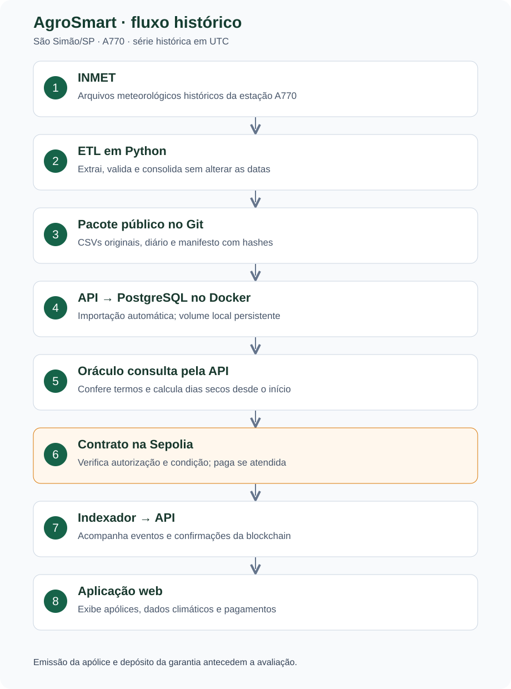

# AgroSmart

Seguro agrícola contra estiagem que paga sozinho, por contrato inteligente.

É uma demonstração acadêmica (TCC). Um produtor de soja contrata uma cobertura sobre
um período passado; um serviço chamado **oráculo** lê a chuva registrada pelo INMET
nesse período e informa ao contrato quantos dias seguidos ficaram secos. Se o número
atingir o gatilho combinado, o contrato transfere a indenização ao produtor, sem
vistoria e sem aprovação manual.

- Dados reais do INMET, estação A770 (São Simão/SP), de 01/01/2020 a 30/09/2026.
- Contratos na **Sepolia**, a rede pública de testes do Ethereum; os valores são ETH de teste.
- Dois perfis fixos: a seguradora (Marina Costa) e o produtor (João Ribeiro).

## Acesso

O sistema está no ar em **[https://35-199-108-185.sslip.io/produtor](https://35-199-108-185.sslip.io/produtor)**.
Não é preciso instalar nada além da extensão [MetaMask](https://metamask.io) no navegador,
com a rede **Sepolia** ativada.

| Perfil | Usuário | Senha |
|---|---|---|
| Produtor | `produtor` | `agrosmart` |
| Seguradora | `seguradora` | `agrosmart` |

A **carteira da seguradora** pertence à equipe do projeto: só nós aprovamos propostas,
criamos as apólices e depositamos as garantias. Quem acessa pelo link usa o perfil do
produtor; o perfil da seguradora pode ser aberto para consulta, mas a aprovação exige a
MetaMask da equipe.

### Como usar como produtor

1. Abra o link e entre com `produtor` / `agrosmart`.
2. Em **Minha carteira**, conecte a MetaMask e vincule a conta: é só uma assinatura,
   sem custo. É nessa conta que a indenização será paga.
3. Em **Meus talhões e seguros**, escolha um talhão livre e vá para **Simular e contratar**.
4. Escolha o período (entre 01/01/2020 e 30/09/2026) e o gatilho em dias secos seguidos,
   confira a simulação com a chuva real do INMET e envie a proposta.
5. A equipe aprova a proposta: a apólice é criada na Sepolia e a garantia é depositada.
6. O oráculo publica o resultado sozinho. Se o gatilho foi atingido, o contrato paga a
   indenização na sua conta; o aviso aparece em **Avisos** e no detalhe da apólice,
   com o link da transação no Etherscan.

O botão **ⓘ** de cada tela mostra esse passo a passo.

## Como funciona

1. **Seguradora** cadastra os talhões do João. O produto (soja, gatilho e valor) já vem pronto.
2. **Produtor** vincula a carteira MetaMask, escolhe talhão, período e gatilho e envia a proposta.
3. **Seguradora** aprova: a MetaMask dela cria a apólice na Sepolia e deposita a garantia
   (o valor da indenização fica guardado no contrato).
4. **Oráculo** lê a série do INMET, confere os termos gravados no contrato e publica o
   primeiro dia em que o gatilho foi atingido, ou o último dia da cobertura.
5. **Contrato** paga a indenização ao produtor se o gatilho foi atingido; se não foi,
   a seguradora resgata a garantia no fim da cobertura.

A interface acompanha tudo pela API e mostra cada transação com link para o Etherscan.

## Regras do seguro

| Regra | Valor |
|---|---|
| Cultura e local | Soja; talhão considerado no mesmo lugar da estação A770 |
| Cobertura | Datas entre 01/01/2020 e 30/09/2026 (UTC, início e fim inclusos) |
| Dia seco | Menos de 1 mm de chuva no dia |
| Dia utilizável | Pelo menos 20 horas válidas de medição; a contratação exige todos os dias utilizáveis |
| Contagem | Dias secos seguidos desde o início da cobertura; chuva ou dia inválido zera |
| Gatilho | De 1 a 366 dias, escolhido pelo produtor na proposta |
| Indenização | Valor fixo do produto, pago uma única vez e por inteiro |
| Propostas | Uma em análise por talhão |
| Carteiras | A do produtor não pode ser a da seguradora nem a do oráculo |
| Beneficiário | Trocar a carteira cadastrada não altera o destinatário das apólices já emitidas |
| Cancelamento | Possível antes da primeira publicação do oráculo; a garantia volta à seguradora |

O gatilho é experimental: não há validação agronômica nem cálculo de prejuízo. O
contrato confere quem publica e se a data está na cobertura, mas confia na contagem
do oráculo autorizado.

## Estrutura

| Pasta | O que tem |
|---|---|
| `interface/` | Aplicação web (React) usada pelos dois perfis |
| `api/` | Backend (Node.js + PostgreSQL): login, cadastros, propostas e leitura da blockchain |
| `oraculo/` | Serviço que calcula os dias secos e publica no contrato |
| `blockchain/` | Contratos Solidity e o script de implantação na Sepolia |
| `etl/` | Ferramenta Python que baixa e prepara os dados do INMET (só para reconstruí-los) |
| `api/recursos/inmet/A770/` | Série do INMET já preparada, importada no banco ao iniciar |
| `configuracao/` | Limites compartilhados: período, estação, perfis, cultura e município |
| `scripts/` | Inicialização pelo Docker, preparo dos dados e o passo a passo para executar o sistema |
| `docker-compose.yml`, `docker-compose.vm.yml` | Serviços do Docker; o segundo acrescenta o HTTPS na VM |
| `docs/` | Diagrama do fluxo |

O `npm start` sobe quatro serviços no Docker: banco (PostgreSQL), API (porta 3001),
oráculo e interface (porta 5173). A Sepolia e a MetaMask ficam fora do Docker.

## Contratos em uso

| Contrato | Endereço na Sepolia |
|---|---|
| Fábrica de apólices | [0xE9CE1a3AC2685ec7Eb54205E6E72eeE4bfaFB386](https://sepolia.etherscan.io/address/0xE9CE1a3AC2685ec7Eb54205E6E72eeE4bfaFB386#code) |
| Registro de oráculos | [0xb9821B9aA456Ce8Ccc2B489c1C7381Ffff1f5Aa3](https://sepolia.etherscan.io/address/0xb9821B9aA456Ce8Ccc2B489c1C7381Ffff1f5Aa3#code) |

O código dos dois está verificado no Etherscan e corresponde à tag `sepolia-2026-10-28`.

Os testes automatizados ficam na máquina da equipe e não acompanham o repositório.
