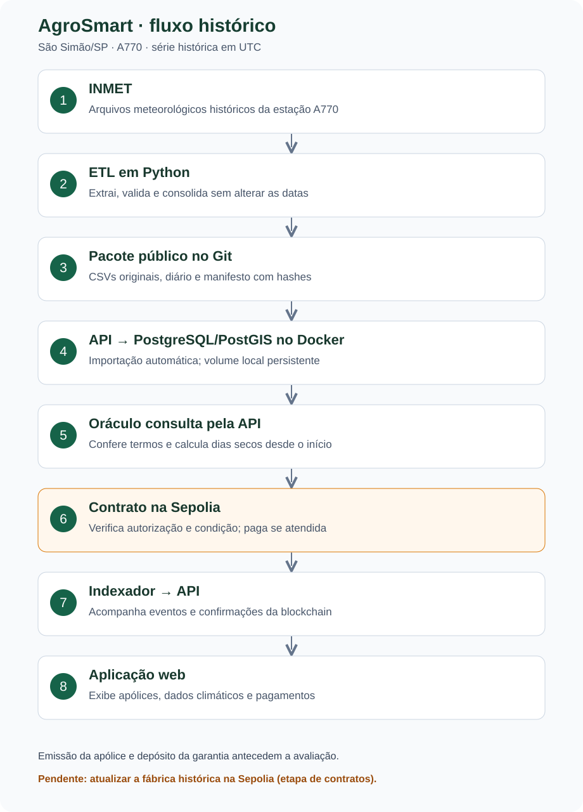

# AgroSmart

Demonstração acadêmica de seguro por estiagem com dados históricos reais do INMET
e indenização integral em parcela única. Usa São Simão/SP (A770), de 2020 a
30/09/2026. O talhão é fictício, considerado coincidente com a estação.
O gatilho é experimental; não estima perda agrícola. Sem visão computacional
ou cobertura de excesso de chuva.

## Executar

Requisitos: Node.js 20.19+ ou 22.12+, Docker Desktop aberto com Compose e
contêineres Linux, e MetaMask na Sepolia para assinar as operações.
Configure `RPC_SEPOLIA` e `CHAVE_PRIVADA_ORACULO` em `contratos/.env`.
A chave deve corresponder ao oráculo autorizado em `contratos/implantacoes/sepolia.json`.
Não compartilhe nem versione chaves privadas ou arquivos `.env`.

Na raiz:

```powershell
npm ci
npm start
```

Abra **http://localhost:5173**. API: **http://localhost:3001/api**.
Usuários de demonstração: `produtor` e `seguradora`; senha `agrosmart`.
Cada papel deve usar sua própria conta autorizada na MetaMask.
Outra instalação precisa configurar suas contas e uma implantação compatível;
as chaves desta instalação não acompanham o projeto.

`npm start` inicia o banco no Docker e API, interface, indexador e oráculo no host.
A série pública já acompanha o Git; a carga no PostgreSQL é automática e não duplica
anos com hashes iguais. O volume Docker preserva o banco **localmente**.
Python e novo download do INMET não são necessários para esse uso.
No primeiro início, Docker baixa a imagem do PostgreSQL/PostGIS.

| Comando | Ação |
|---|---|
| `npm run status` | Verifica os serviços; não comprova assinatura ou pagamento |
| `npm stop` | Encerra a aplicação, mantendo o banco |
| `npm run banco:parar` | Para o banco sem apagar o volume |
| `npm run dados:preparar` | Reconstrói o pacote INMET; requer Python, veja [ETL](simulador/README.md) |

## Fluxo



Na interface, o produtor vincula a carteira e marca **Usar dados historicos de
Sao Simao (A770)**. Depois escolhe cobertura e gatilho e envia a proposta. Emissão e depósito de garantia são assinados pela seguradora antes
da avaliação. O recebimento da indenização não exige assinatura do produtor.
O prêmio exibido é informativo e não é cobrado pelo contrato.

**Pendente na etapa de contratos:** a fábrica pública atual (`clima-integral-v1`)
ainda não emite `ApoliceHistorica`. A consulta dos dados funciona; a emissão
histórica fica bloqueada até atualizar e verificar a fábrica na Sepolia.
Isso não impede usar ou verificar o ETL. Veja [escopo atual](docs/ESCOPO-ATUAL.md).

## Organização e testes

| Pasta | Responsabilidade |
|---|---|
| `simulador/` | Somente ETL: extração, validação e consolidação do INMET |
| `backend/` | API, carga e consultas no PostgreSQL/PostGIS, cadastros e indexação |
| [`oraculo/`](oraculo/README.md) | Conferência da série, cálculo e publicação em cadeia |
| `contratos/` | Autorização, garantia e pagamento |
| `app/` | Interface web |
| `testes/` | Suítes, configurações e evidências |
| `docs/` | Escopo e explicações técnicas |

`npm test` executa as suítes; exige Slither no PATH e o ambiente Python com
as dependências de desenvolvimento descritas no [ETL](simulador/README.md).
`npm run testar:docker` verifica PostgreSQL real em um volume temporário separado.
Resultados gerados ficam em `testes/gerados`, fora do Git. Testes locais não
comprovam funcionamento da MetaMask ou pagamento na Sepolia.
