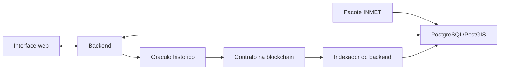

# Backend

API Node.js/Express do AgroSmart, com PostgreSQL/PostGIS.

## O que faz

- Autentica usuarios, controla perfis e comprova a carteira do produtor por assinatura.
- Cadastra produtores, propriedades, talhoes e produtos; mede area pelo PostGIS.
- Importa o pacote publico INMET A770 e consulta sua serie historica.
- Calcula cotacoes, registra propostas historicas e prepara os termos para a seguradora assinar na MetaMask.
- Confere a emissao na blockchain e indexa garantia, publicacoes, pagamentos e cancelamentos.
- Entrega dados ao oraculo pela API autenticada e apresenta relatos, notificacoes e auditoria.

O backend nao guarda a chave do produtor, nao assina transacoes e nao transfere indenizacoes.
O oraculo calcula o indice; o contrato decide e executa o pagamento.



## Executar

Na raiz, com Docker Desktop aberto e a configuracao Sepolia preenchida:

```powershell
npm ci
npm start
```

Interface: http://localhost:5173. API: http://localhost:3001/api.
Usuarios iniciais de demonstracao: `produtor` e `seguradora`, senha `agrosmart`.
`npm run status` consulta os processos; `npm stop` encerra a aplicacao.

O inicio importa o pacote INMET uma vez por versao. O volume Docker preserva o banco;
novas instalações importam o mesmo pacote versionado. A API executa no Docker. Segredos ficam no ambiente ou em `.env`, fora do Git.

## Arquivos

| Caminho em `src/` | Responsabilidade |
|---|---|
| `index.js`, `app.js`, `config.js` | Inicializacao, rotas e configuracao |
| `banco/` | Conexao, esquema atual, importacao INMET e cadastros iniciais |
| `seguranca/` | Senhas, sessoes, segundo fator, permissoes e auditoria |
| `dominio/` | Cotacao, termos, validacao historica, documentos e geometria |
| `rotas/` | Operacoes HTTP por area do sistema |
| `cadeia/` | Consultas e indexacao dos eventos da blockchain |
| `notificacoes/` | E-mails; sem SMTP, arquivos `.eml` locais |

## Limites e verificacao

Novas propostas sao exclusivamente historicas: A770, 2020 a 30/09/2026, gatilho
experimental de 1 a 366 dias e contagem desde o inicio da cobertura. Dias incompletos
bloqueiam a contratacao. A data climatica original nao e a data da transacao atual.

A fábrica histórica atual está implantada e verificada na Sepolia.
Cadastro, consulta, proposta e emissão usam a fábrica histórica do manifesto atual.

O banco e inicializado por `src/banco/esquema.sql`, que contem somente as tabelas
do fluxo atual. Nao existe cadeia de migracoes de funcionalidades retiradas.

Uso e testes utilizam somente PostgreSQL/PostGIS. A configuracao compartilhada
`configuracao/historico.json` fixa a estacao e os limites de data; o banco e o contrato
tambem recusam datas fora desse recorte.

Integração dos componentes: [arquitetura](../docs/ARQUITETURA.md).
