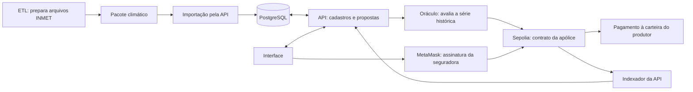

# Interface

Aplicação web em React usada pela seguradora e pelo produtor. Roda no Docker pelo
`npm start` da raiz e abre em http://localhost:5173. Usa a MetaMask para assinar.

## Telas

| Perfil | Tela | O que faz |
|---|---|---|
| Seguradora | Painel | Apólices, indicadores, saldo da seguradora, situação do oráculo e endereços dos contratos |
| Seguradora | Propostas | Aprova a proposta (cria a apólice na MetaMask), deposita a garantia ou recusa |
| Seguradora | Talhões | Cadastra e remove talhões do João |
| Produtor | Meus talhões e seguros | Talhões, propostas e apólices; pede proposta para um talhão livre |
| Produtor | Simular e contratar | Escolhe período e gatilho, vê a cotação e envia a proposta |
| Produtor | Minha carteira | Vincula a conta MetaMask que vai receber a indenização |
| Ambos | Detalhe da apólice | Termos, publicações do oráculo e histórico de transações |

Painel, propostas, seguros, carteira e avisos consultam atualizações a cada 20 segundos
com a aba visível. O detalhe da apólice acompanha os eventos do contrato. O botão ⓘ do
topo mostra o passo a passo de cada perfil.

## Organização de `src/`

| Pasta | Conteúdo |
|---|---|
| `paginas/` | Telas do produtor, da seguradora e comuns |
| `componentes/` | Cabeçalho, ajuda, cartões e elementos reutilizados |
| `cadeia/` | MetaMask, chamadas aos contratos e formatação de valores |
| `api/` | Chamadas à API e atualização automática |
| `sessao/` | Login e perfis |

Antes do build, `scripts/sincronizar-enderecos.mjs` copia os endereços dos contratos
de `blockchain/implantacoes/sepolia.json`.

## Integração

A interface consulta a API em `/api` e lê termos, índices e eventos na Sepolia.
O oráculo executa em serviço separado; a interface não publica índices climáticos.
O produtor vincula a carteira assinando uma mensagem sem custo de gás. A seguradora
assina duas transações: emissão e depósito da garantia. O pagamento automático
não exige outra assinatura do produtor.

As datas de cobertura são históricas e exibidas em UTC. Cancelar exige que a
reprodução ainda não tenha começado; o resgate sem acionamento exige a publicação
do último dia pelo oráculo. O tempo atual do computador não libera essas ações.
