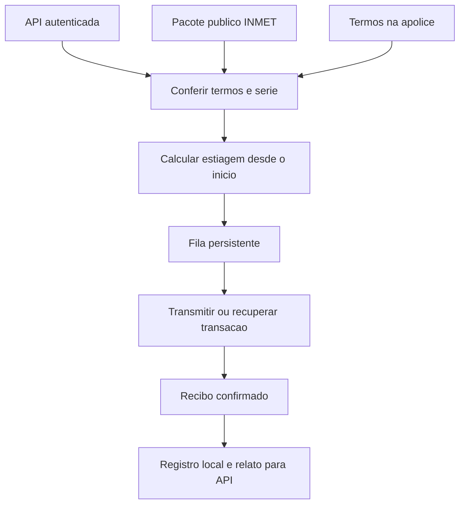

# Oráculo histórico

Consulta a série de São Simão/SP (A770) pela API do backend, calcula os dias secos
**desde o início da cobertura** e publica o resultado no contrato histórico.
Não simula sensores, não desloca datas e não acessa o PostgreSQL diretamente.
A interface utiliza o modo histórico. Novas propostas convencionais são recusadas
pelo backend; apólices convencionais antigas são ignoradas pelo serviço.

## Funcionamento

1. Consulta apólices históricas ativas, após o depósito da garantia.
2. Busca os dias e os termos na API autenticada.
3. Confere o texto e o hash dos termos com a apólice; confronta os dias recebidos
   com os CSVs e hashes do pacote público `api/recursos/inmet/A770`.
4. Conta dias com chuva inferior a 1 mm; dia utilizável exige ao menos 20 horas
   válidas. Uma cobertura incompleta bloqueia a publicação.
5. Enfileira o primeiro acionamento; sem acionamento, enfileira o último dia.
6. Assina, transmite, aguarda confirmação e relata o recibo ao backend. O contrato
   decide e executa o pagamento integral; o oráculo não transfere a indenização.

O serviço usa uma única fonte e um único operador. Hash comprova integridade em
relação ao pacote contratado, não a verdade meteorológica nem assinatura do INMET.

## Executar

Use `npm start` na raiz. O iniciador fornece RPC, chave do oráculo, autenticação da
API e diretório de estado. Os segredos ficam fora do Git; a chave do produtor não
é usada pelo oráculo. A chave de serviço da API é diferente da chave da blockchain.

Use os comandos abaixo na raiz, com o serviço Docker iniciado:

| Comando | Função |
|---|---|
| `docker compose exec oraculo node src/index.js status` | Conta, saldo e autorização |
| `docker compose exec oraculo node src/index.js fila` | Fila da instância em uso |
| `docker compose exec oraculo node src/index.js estatisticas` | Registros de publicação |
| `docker compose logs --tail 50 oraculo` | Ciclos e falhas do serviço |

Não inicie outro serviço sobre a mesma fila. O estado fica em `.execucao/oraculo`.
O período vem da cobertura histórica, nunca do dia atual.

## Arquivos

| Arquivo em `src/` | Responsabilidade |
|---|---|
| `index.js`, `ciclo.js` | Comandos e execução dos ciclos históricos |
| `clienteBackend.js` | Consulta e relatos pela API autenticada |
| `vinculoHistorico.js` | Conferência dos parâmetros com o compromisso em cadeia |
| `serieHistorica.js` | Conferência do pacote e da série recebida |
| `historico.js` | Regra de estiagem, sem rede ou gravação |
| `oraculo.js` | Preparo, fila, publicação e auditoria |
| `fila.js` | Estado persistente e retomada |
| `publicador.js`, `abi.js` | Comunicação com o contrato e recibos |
| `registro.js` | Procedência, gas e latência observada |
| `config.js` | Configuração por ambiente |

## Falhas e testes

O hash da transação transmitida é salvo antes de esperar a confirmação. Ao retomar,
o serviço consulta esse hash, sem transmitir outra transação. Uma falha posterior
na auditoria ou no relato não transforma pagamento confirmado em novo envio.
Gravações da fila usam arquivo temporário e troca de nome. Filas inválidas causam
erro explícito. Tentativas esgotadas exigem revisão; `fila --reabrir <chave>` deve
ser usado somente após conferir o motivo e a cadeia, com o serviço parado.
Há uma janela de falha antes de o RPC devolver o hash; nessa situação, confira a
cadeia antes de reabrir. O contrato impede repetir o mesmo período.

Dentro de `oraculo/`, `npm run cobertura` executa testes unitários e integração em
nó local. Arquivos, configurações e evidências ficam em `testes/`. O fluxo completo
API/banco/oráculo/EVM está em `testes/blockchain/unitarios/FluxoHistorico.test.js`.
Recibos recuperados após interrupção não entram na média de latência, pois o horário
observado não revela quando ocorreu a confirmação original.

A fábrica histórica está implantada e verificada na Sepolia. Testes locais e
serviços ativos não comprovam contratação com MetaMask ou pagamento público.
