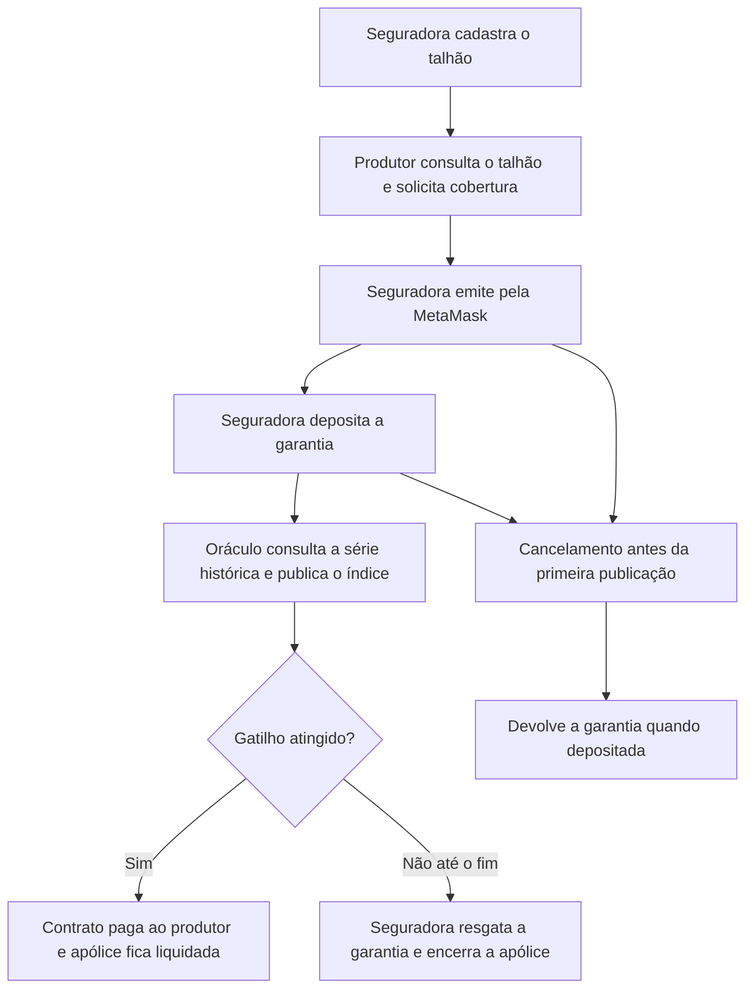

# Testes do AgroSmart

A validação acompanha o uso do seguro: cadastrar um talhão, disponibilizá-lo ao
produtor, solicitar uma cobertura, emitir a apólice, depositar a garantia e
conferir o desfecho na interface e na Sepolia. Os testes automatizados verificam
as regras e as falhas que podem interromper essas etapas.

## Fluxo avaliado



O cadastro integrado foi testado com interface, API e PostgreSQL reais em ambiente
automatizado; o transporte HTTP foi adaptado ao teste. As capturas locais de
cadastro registram um talhão próprio desse ensaio. Os cenários da VM utilizam o
talhão `talhao-alunos`, já cadastrado: não são apresentados como uma única execução
contínua iniciada naquele cadastro local.

## Cenários e evidências do sistema

| Caminho | O que foi feito | Como conferir o resultado |
| --- | --- | --- |
| Cadastro e acesso do produtor | A seguradora cadastrou dois talhões; após sair e entrar como produtor, ambos ofereceram solicitação de proposta | Asserções da interface integrada com API e PostgreSQL; capturas locais 01 e 02 documentam outro cadastro, sem pagamento |
| A — pagamento | Proposta de 01–30/06/2024, gatilho 10; emissão e garantia pela MetaMask; publicação automática | Liquidada; 0,006 ETH ao produtor; recibo, evento de pagamento, estado da apólice e API; capturas 03–08 e 11 |
| B — encerramento sem acionamento | Cobertura de 20–21/02/2024, gatilho 10; índice final 0; resgate pela seguradora | Encerrada; nenhum pagamento ao produtor e 0,006 ETH devolvidos; capturas 12–20 e recibos |
| C1 — cancelamento sem garantia | Emissão seguida de cancelamento antes do depósito e da publicação | Cancelada; nenhum depósito, publicação ou pagamento; capturas 21–24 e recibos |
| C2 — cancelamento com garantia | Emissão, depósito de 0,006 ETH e cancelamento antes da publicação | Cancelada; garantia devolvida e nenhum pagamento ao produtor; capturas 25–28 e recibos |

Os quatro caminhos de apólice foram executados com ETH de teste na Sepolia. Nos
cancelamentos, o oráculo foi pausado para controlar a ordem das operações. B tem
dois dias de cobertura e gatilho dez: verifica o encerramento e o resgate, sem
avaliar uma estiagem em período longo. O relatório em `evidencias/` reúne os
resultados, os prints selecionados e os identificadores públicos das operações.

## Como os testes automatizados sustentam o fluxo

| Etapa do uso | Regra ou falha verificada | Por que isso importa |
| --- | --- | --- |
| Cadastrar e consultar o talhão | Persistência, associação ao produtor fixo e acesso por perfil | O produtor precisa encontrar o talhão correto para contratar |
| Escolher cobertura e enviar proposta | Datas de 2020–2024, gatilho válido, carteira vinculada e uma proposta pendente por talhão | Impedir uma solicitação que o sistema não possa processar |
| Emitir e ativar a apólice | Conferência de termos, produtor, valor, gatilho e datas; depósito exato e autorização | O contrato emitido deve representar a proposta e ter garantia suficiente |
| Avaliar a estiagem | Integridade do pacote, tratamento auditável, contagem desde o início e reinício com chuva | O índice deve seguir a regra contratada e a série identificada |
| Publicar e pagar | Oráculo autorizado, pagamento único, retomada da fila e recuperação de recibo | Uma falha de comunicação não deve gerar um segundo pagamento |
| Cancelar ou resgatar | Momento permitido, papel autorizado e destino dos fundos | Conferir devolução à seguradora e bloquear operações indevidas |
| Acompanhar o resultado | Indexação, reconciliação, notificações e atualização da tela | A interface deve refletir o estado confirmado na rede |
| Reiniciar a instalação | Importação sem duplicatas e persistência Docker | Preservar dados e permitir continuidade do uso |

A execução registrada contabiliza 353 testes distintos aprovados. Essa quantidade
e a cobertura descrevem os casos automatizados; a comprovação dos desfechos do
seguro está nos cenários acima. Análise estática com Slither complementa as
verificações dos contratos e não constitui auditoria de segurança.

## Preparar e executar

Requisitos: Node.js compatível com o projeto, dependências instaladas com `npm ci`,
Docker em execução, Python e Slither disponível no PATH. Prepare o ambiente Python:

```powershell
python -m venv etl/.venv
./etl/.venv/Scripts/python.exe -m pip install -e "./etl[dev]"
python -m pip install slither-analyzer
npm test
```

O cache do pytest fica desativado pela configuração e pelo runner. As saídas de
cobertura e os temporários ficam em `gerados/`; uma execução separada confirmou os
26 testes do ETL com pytest 9.2.0. Essa verificação está registrada no relatório
de evidências de 03/11/2026.

No Linux, o executável Python do ambiente é `etl/.venv/bin/python`. O runner usa
esse caminho automaticamente. O usuário PostgreSQL precisa poder criar bancos;
a fixture inicia o servidor Docker e cria somente bancos descartáveis
`agrosmart_teste_<UUID>`. O ensaio Docker usa projeto e volume próprios.

Para executar um grupo:

```powershell
npm run cobertura --workspace api
npm run testar:integracao --workspace api
npm run cobertura --workspace oraculo
npm run cobertura --workspace interface
npm run testar:docker
```

A suíte completa também compila os contratos, mede sua cobertura, executa o
Slither, gera o build da interface e verifica o ETL. Não exige a chave privada
do produtor nem movimenta ETH da Sepolia.

## Alcance da execução

`npm test` executa as suítes, o build e a análise estática; não abre a MetaMask
nem realiza os cenários públicos automaticamente. As integrações usam PostgreSQL
e EVM local isolados; testes de tela podem usar respostas controladas de carteira
e API. Essas fronteiras estão identificadas nas fixtures.

Testes, fixtures e configurações ficam em `testes/`; saídas locais ficam em
`gerados/`, ignorado pelo Git. Somente evidências selecionadas são versionadas.
Uma captura de saldo não identifica, sozinha, a origem de um pagamento. Para
cada operação na Sepolia, conferir também endereço, hash, recibo e eventos.
