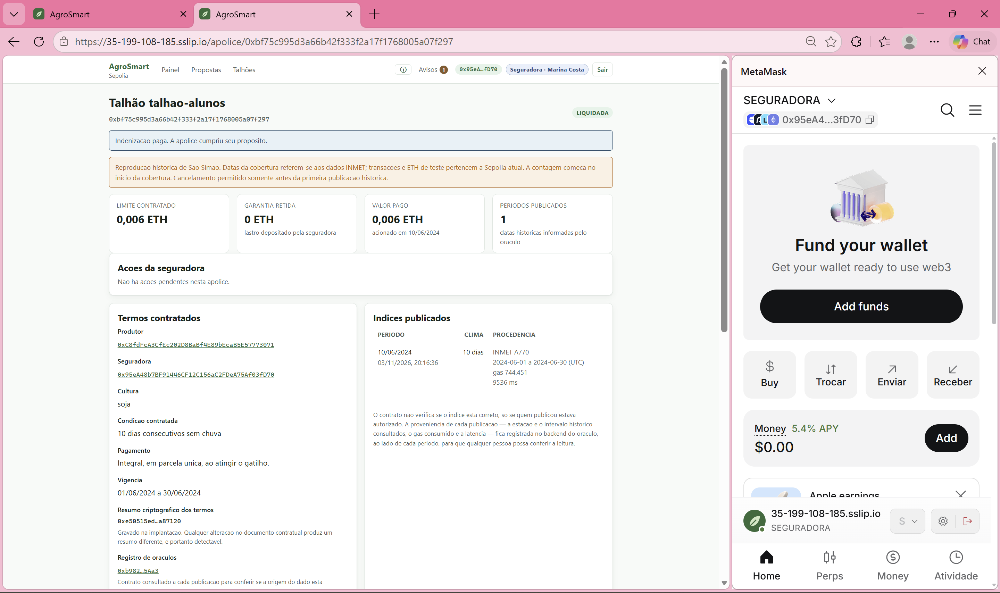
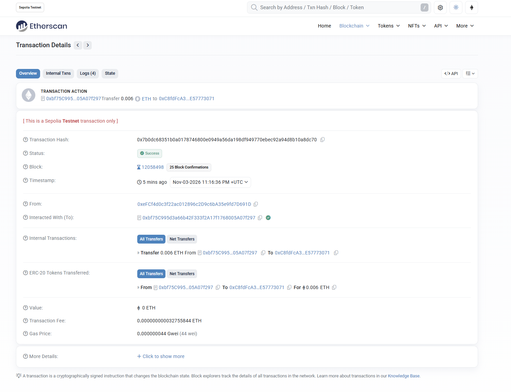
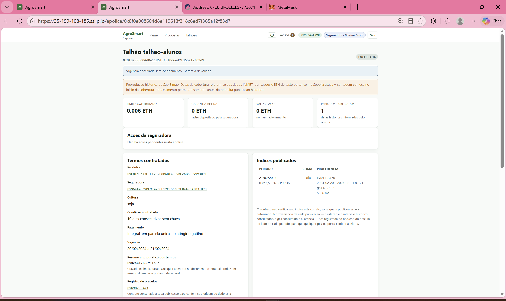
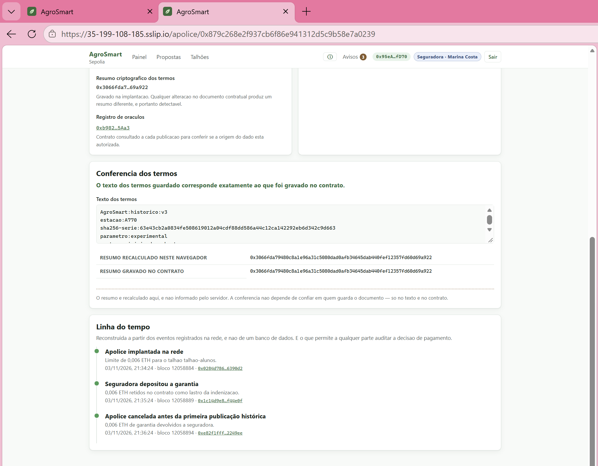

# Resultados da validação do AgroSmart

Esta validação reúne um cadastro integrado e quatro apólices executadas na
Sepolia em 03/11/2026. O cadastro local e os cenários da VM são execuções distintas.
As capturas mostram a interação; recibos, eventos e estado contratual confirmam
a movimentação de ETH de teste.

## Cadastro e contratação

O teste de cadastro integrado criou dois talhões pela interface da seguradora,
encerrou a sessão e entrou como produtor. Ambos apareceram com a opção de solicitar
proposta. Foram usados interface, API e PostgreSQL reais, transporte HTTP adaptado
e indexação desligada. Não houve assinatura MetaMask nessa verificação.

As capturas 01 e 02 mostram outro cadastro local, `tcc-20261103-liquidacao`.
As apólices abaixo usam `talhao-alunos`, já cadastrado na VM.

## Resultados na Sepolia

| Cenário | Cobertura e ação | Resultado confirmado | Prints |
| --- | --- | --- | --- |
| A — pagamento | 01–30/06/2024, gatilho 10; emissão e depósito pela seguradora | Índice 10 em 10/06; 0,006 ETH ao produtor; Liquidada, saldo zero | 03–08 e 11 |
| B — resgate | 20–21/02/2024, gatilho 10; publicação final e resgate | Índice 0; nenhum pagamento ao produtor; 0,006 ETH devolvidos; Encerrada, saldo zero | 12–20 |
| C1 — cancelamento sem garantia | 01–30/06/2024, gatilho 10; cancelar antes do depósito/publicação | Cancelada, sem depósito, publicação ou pagamento | 21–24 |
| C2 — cancelamento com garantia | Mesma cobertura e gatilho; depositar e cancelar antes da publicação | Cancelada; 0,006 ETH devolvidos; nenhuma publicação ou pagamento | 25–28 |

Nos cancelamentos, o operador pausou o oráculo para controlar a ordem do ensaio e
o retomou ao terminar. B tem dois dias e gatilho dez: verifica o encerramento e
resgate, mas não a discriminação de estiagem em uma cobertura longa.

### Pagamento ao produtor

*Cenário A: Liquidada, valor pago 0,006 ETH e garantia zero. A extensão aberta é a
da seguradora; não é prova do saldo do produtor.*

*Recibo com sucesso e transferência interna da apólice ao produtor. O campo
Value de zero é o valor enviado pelo oráculo na chamada, não a indenização.*

### Devolução da garantia

*Cenário B: encerramento sem indenização ao produtor e garantia devolvida.*

### Cancelamento com garantia

*Cenário C2: emissão, depósito e cancelamento antes da primeira publicação.*

### Identificadores para conferência

| Cenário | Apólice | Transação do desfecho |
| --- | --- | --- |
| A | `0xbf75c995d3a66b42f333f2a17f1768005a07f297` | `0x7b0dc68351b0a0178746800e0949a56da198df949770ebec92a94d8b10a8dc70` |
| B | `0x8f0e008604d8e119613f318c6ed7f365a12f83d7` | `0xd72aa6afbe93272d86a9e0b58f2798265d1830f39da8565fbb8363388da16a84` |
| C1 | `0x4e1fd4fd422b02cfbc064c3dda2b9633bedc8b6a` | `0x2e1b62f4a5270378acf64a18e5747fe7ac7405272be1db9aed5dcbe29f96050a` |
| C2 | `0x879c268e2f937cb6f86e941312d5c9b58e7a0239` | `0xe82f1ffff54ed2f4db0a5fef9459954cd3ecf27f782d75f6aa86c861a22249ee` |

Os 12 recibos de emissão, depósito, publicação, resgate e cancelamento tiveram
status 1. A leitura final conferiu situação, saldo, valor pago e eventos. A API
também confirmou os estados finais; C1 e C2 estão Canceladas na conferência final
de 04/11/2026, após atualização da VM.

## Suíte automatizada nesta validação

O pacote de dados tinha 1.827 dias utilizáveis, com seis preenchimentos identificados.
A execução consolidada registrou **353 testes distintos aprovados**: contratos 89,
configuração 2, API 75, integração da API 12, oráculo 51, integração do publicador 4,
interface 76, infraestrutura 18 e ETL 26. Os quatro testes de banco repetidos pelo
runner foram contados uma vez. Os casos de safra acrescentados posteriormente não
estão nessa medição.

| Componente | Cobertura de linhas | Cobertura de ramos |
| --- | ---: | ---: |
| Contratos | 99,12% | 92,19% |
| API | 75,45% | 78,01% |
| Oráculo | 93,70% | 84,96% |
| Interface | 90,08% | 80,08% |

O ETL teve 90,69% das instruções. Slither 0.11.6 analisou três contratos com 102
detectores e zero achados na configuração executada, com dependências filtradas
e supressões pontuais. O build da interface concluiu. Cobertura não prova ausência
de defeitos; análise estática não equivale a auditoria independente.

Ambiente registrado: Windows, Node.js 24.19.0, npm 11.17.0, Python 3.12.10 e
PostgreSQL 16 no Docker. O ETL passou com pytest 9.1.1 e, em execução separada,
com pytest 9.2.0 usando o cache desativado. Integrações automatizadas usam EVM
isolada; os quatro cenários públicos utilizam MetaMask e Sepolia.

## Arquivos da evidência

| Local | Conteúdo |
| --- | --- |
| `prints/01` a `02` | Cadastro local |
| `prints/03` a `11` | Emissão, pagamento e conferências de A; 09 mostra a fonte individual não verificada e 10 a fábrica verificada |
| `prints/12` a `20` | Publicação sem acionamento e resgate de B |
| `prints/21` a `28` | Cancelamentos C1 e C2 |
| `registros/cenario-*-sepolia.json` | Recibos, eventos e leituras das apólices; B tem registro da publicação e outro do resgate |
| `registros/cenario-*-api.json` | Respostas da API; estados finais dos cancelamentos em `conferencia-vm-apos-ajustes.json` |
| `registros/resumo.json` | Contagem e medições da execução consolidada |
| `registros/ajustes-integracao.json` | Rodada de regressão da integração; não somar novamente ao total |
| `registros/consultas-reais.json` | Simulações sem transação; a consulta negativa de janeiro não é a apólice B de fevereiro |
| `registros/saude-vm.json`, `registros/conferencia-vm-apos-ajustes.json` | Consultas operacionais e conferência final da VM |

## Repetir os cenários

Use a instalação com MetaMask e Sepolia. Confira fábrica, perfil e conta antes de
assinar. Cada repetição exige uma nova proposta/apólice e consome ETH de teste.

1. Seguradora cadastra o talhão; produtor confirma o cadastro e vincula a carteira.
2. Produtor escolhe período e gatilho da tabela e envia a proposta.
3. Seguradora confere os termos, emite pela MetaMask e deposita 0,006 ETH.
4. Em A, aguarde o oráculo e confira pagamento único; em B, aguarde a publicação
   final e resgate a garantia. Para C1/C2, pause o oráculo antes da emissão e
   cancele antes da primeira publicação, sem/com depósito; depois retome o serviço.
5. Atualize a página após a confirmação. Registre endereço, hash, recibo, eventos,
   situação final, destinatário e valor, além da captura da tela.

## Limites da comprovação

O gatilho é experimental e não mede prejuízo agrícola. O contrato confia no índice
do oráculo autorizado. A transferência direta reverte se o beneficiário rejeitar
ETH. A fábrica está verificada na tag `sepolia-2026-11-03`; as apólices individuais
não têm fonte verificada no explorador. Não se mediu disponibilidade contínua,
desempenho sob carga ou usabilidade com participantes externos.

A captura 11 mostra saldo e total acumulado de outras apólices, não só A. A captura
28 mostra a notificação com conta MetaMask divergente; não comprova uma assinatura
do produtor nem, sozinha, um bloqueio completo de operação.
